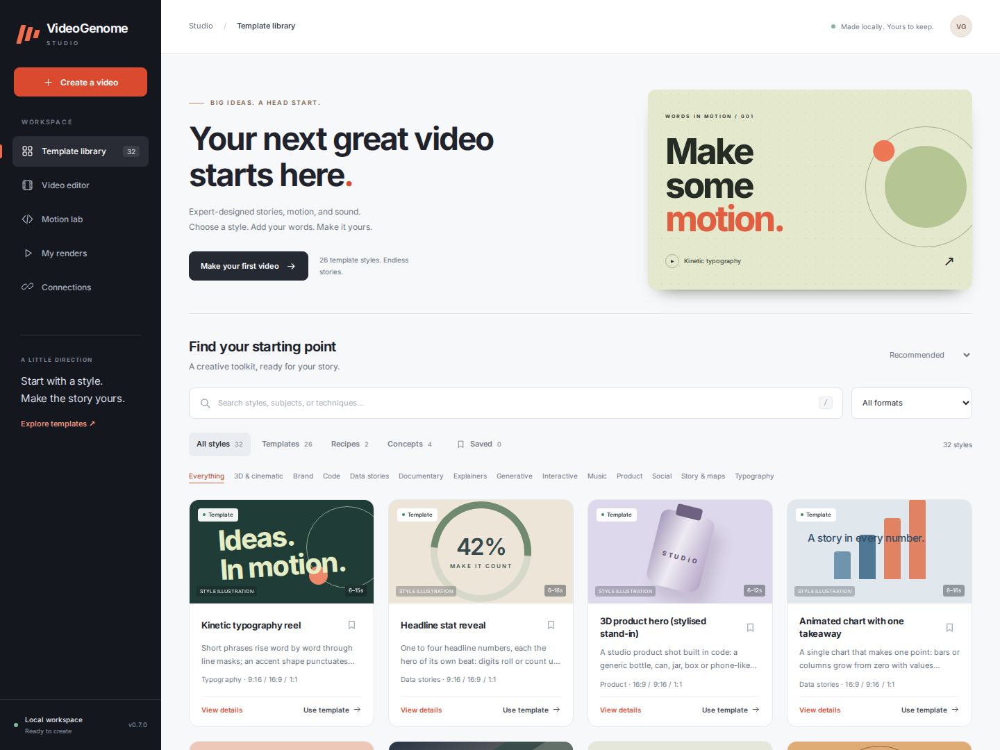
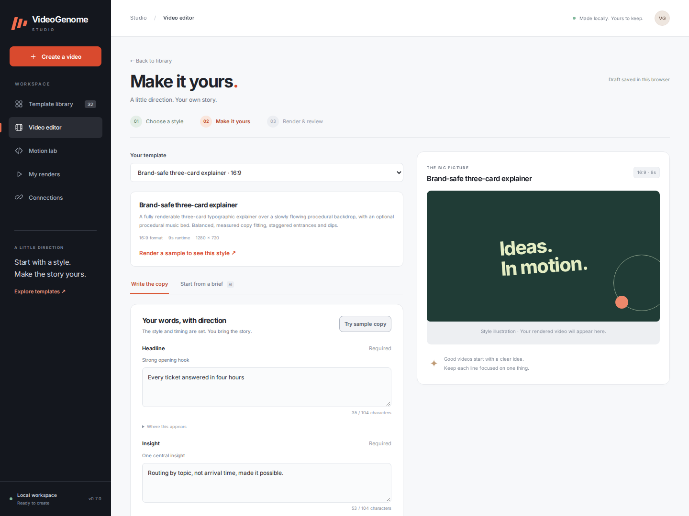

# Studio interface previews

Actual Chromium screenshots of the Studio application, captured by the
`studio` GitHub Actions job from commit `bf0fbb1dbd390536afcee7cb3e0c20a8e1ff28dd`.
The nine Studio browser/service checks passed in
[run 39145662386](https://github.com/djeada/VideoGenome/actions/runs/39145662386).
The images are unmodified; the sample copy is from the repository's examples.

| Screen | Desktop | Mobile |
| --- | --- | --- |
| Template library | [Open](studio-library-desktop.png) | [Open](studio-library-mobile.png) |
| Video editor | [Open](studio-editor-desktop.png) | [Open](studio-editor-mobile.png) |





Cards without a rendered sample use original, code-native illustrations,
explicitly labeled **Style illustration** in the UI. They do not claim to be
frames from a completed video. The editor's mobile layout puts copy before the
preview; completed renders expose the player, downloads and review results.

To reproduce the screenshots and interactive checks:

```bash
VIDEOGENOME_UI_ARTIFACTS=/tmp/vg-studio-ui python -m unittest tests.test_studio_ui -v
```

The tests use an isolated workspace and an FFmpeg-only test pipeline to exercise
the editor without producing optional media or calling a writing model.
